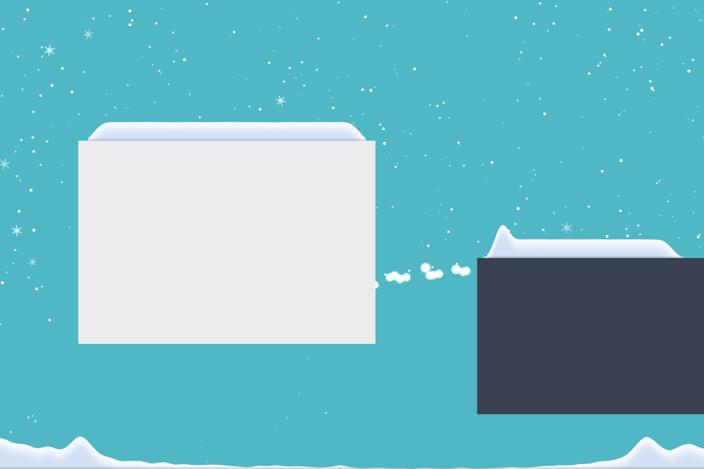

# Schneefall ❄️

A tiny macOS menu-bar app that makes it snow on your desktop, behind all your windows. Snow piles up on top of every window and along the bottom of the screen. Yank a window and the snow slides off. Tilt your MacBook and the snow still falls "down".

*Schneefall* is German for "snowfall". The app's interface is in German.



*Synthetic test render (`Schneefall --snapshot`). On a real desktop the snow sits behind your windows.*

## Features

- **Snow at desktop level.** Flakes drift with wind and sway behind every window, with the occasional spinning ice crystal.
- **Snow caps on windows.**
  - They rest on each window's top edge and start where the rounded corners end.
  - The edges taper off softly.
- **Snow on the ground.** It collects along the bottom of every screen.
- **Moving windows.**
  - A gentle drag carries the cap along.
  - A jerky one makes it slip, and the overhang falls off in clumps onto the window below or the ground.
  - A quick downward drag lets the cap float for a moment, and a jerk upward makes it hop.
- **Changing windows.**
  - Making a window narrower drops the overhang.
  - Closing it drops all of its snow.
  - Minimizing it or switching Spaces freezes the cap until the window comes back.
  - "Show Desktop" carries the caps along rigidly.
- **Gentle thaw.** The higher the snow, the faster it melts, so it levels off. Under windows, where no new snow arrives, it slowly disappears.
- **Screen edges are walls.** Nothing falls out of the picture. Flakes blown against a side re-enter on the other side.
- **Follows the tilt** (Apple-silicon MacBooks). The built-in accelerometer tells the app where "up" is.
  - From about 20° on, lying snow slides downhill as a slab.
  - Past a quarter turn, snow comes in from the side, or from below if the MacBook is upside down, like a snow globe.
- **Four strengths.** Light, Medium, Strong and Snowstorm. The storm has gusts from 50 to 470 pt/s and heavy turbulence.
- **Multiple displays.** Every screen gets snow. Optionally, snow falls through from an upper monitor onto the one below.
- **Frugal.** When all windows are maximized or a full-screen app is in front, the app sleeps (≈ 0 % CPU).

## Install

1. Unzip `Schneefall.zip` and drag `Schneefall.app` into Applications.
2. The app is only ad-hoc signed, not notarized by Apple. So on the **first** launch:
   1. Double-click it and dismiss the warning with "Done".
   2. Open **System Settings → Privacy & Security → "Open Anyway"**.
   3. Or, in Terminal: `xattr -dr com.apple.quarantine /Applications/Schneefall.app`
3. A ❄︎ appears in the menu bar.

The app needs no special permissions, neither Screen Recording nor Accessibility.

**Requirements:** macOS 14 or later, Apple silicon or Intel. "Follow tilt" works on Apple-silicon MacBooks only.

## Menu ❄︎

| Item | What it does |
|---|---|
| Pause / Weiter schneien | Pause hides the snow and stops everything, and the scene is kept. Weiter schneien resumes. |
| Stärke ▸ Leicht · Mittel · Stark · Schneesturm | Strength: Light, Medium, Strong, Snowstorm. The choice is remembered. |
| Schnee abtauen | Melt everything: clears all lying and falling snow. |
| Gestapelte Monitore: Schnee nur unten | Stacked monitors: the upper monitor gets no ground, so snow falls through. |
| Neigung folgen | Follow tilt: gravity follows the accelerometer. Only shown if the sensor exists. |
| Beim Login starten | Start at login, via `SMAppService`. |
| Beenden | Quit (⌘Q). |

## Build

You need Xcode or a Swift 6 toolchain. There are no other dependencies.

```sh
swift test                         # tests of the simulation (SnowCore)
scripts/build-app.sh               # build/Schneefall.app (universal, ad-hoc signed)
scripts/build-app.sh --install     # replace /Applications/Schneefall.app and launch it
scripts/build-app.sh --zip         # build/Schneefall.zip with the app and a German install guide
swift run Schneefall --snapshot out.png   # off-screen test render
```

**Icon.** `swift scripts/make-icon.swift icon.png` draws the 1024 px artwork. Turn it into `Resources/AppIcon.icns` with `sips` (into an `AppIcon.iconset`) and `iconutil -c icns`. The exact commands are in the header of `build-app.sh`.

## How it works

```
Sources/
  SnowCore/            pure simulation, no AppKit, covered by `swift test`
    Tuning.swift       every knob in one place
    Surface.swift      height profile in 2-pt columns: deposit, angle of repose, sliding, thaw
    Pile.swift         a window's cap: friction, lift-off, shedding, slab sliding
    World.swift        flakes, clumps, window sync, grounds, direction of gravity
    Coverage.swift     is the desktop completely covered by windows?
  Schneefall/          the app
    WindowTracker      window geometry via CGWindowList (public data, no permissions)
    Overlay            one transparent, click-through window per screen at desktop level
    Engine             display-link loop, polling, sleeping, frame rate, sensor on/off
    Renderer           Metal: snow surfaces as triangle strips, instanced flakes and crystals
    TiltSensor         accelerometer in the sensor processor (SPU) via IOKit HID
    AppDelegate        menu, settings, login item
    Snapshot           `--snapshot`: synthetic scene rendered to PNG
```

**Key ideas**

- **Desktop level.**
  - The overlay sits at `kCGDesktopWindowLevel + 1`, above the wallpaper and below the desktop icons.
  - It joins all Spaces but not full-screen ones, and leaves the menu bar out.
  - The window server takes care of hiding snow behind windows.
- **Caps follow their window with limited friction.**
  - The cap's velocity relative to the window decays by at most μg. A gentle drag carries the cap along, a jerk makes it slip.
  - Columns that lose their support become clumps.
  - When a window moves without a mouse button pressed, such as "Show Desktop" or tiling, the cap is carried rigidly.
- **Landing.** A particle lands once it reaches the snow layer, as long as it started above the surface's base and not from behind the window. That keeps a dense curtain of clumps from falling through snow that just piled up beneath it.
- **Height limits.** The caps (24 pt for windows, 60 pt for the ground) only limit new snowfall. Snow that merely moves is never destroyed.
- **Gravity.**
  - The simulation runs in the screen turned by quarter turns, with hysteresis at 70°.
  - The remaining tilt makes flakes fall diagonally and, from 20° on, makes lying snow slide as a slab.
  - Turning past a quarter drops everything lying toward the new "down".
- **Frugality.**
  - The app sleeps when nothing is visible. It needs its own coverage test, because rounded window corners keep macOS from ever reporting the overlay as hidden.
  - It runs at 30 fps on battery and only goes up to 60 fps for big motion.
  - Resting surfaces are neither settled nor re-meshed.
  - It renders at 1 px per point.

## Knobs

Everything lives in `Sources/SnowCore/Tuning.swift`, for example:
- cap height `pileCap` and ground height `groundCap`
- angle of repose via `reposeMaxStep`
- grip `friction`
- clump gravity and terminal speed: `clumpGravity`, `clumpTerminal`
- corner inset `cornerInset`
- thaw `meltRate`
- flake density per strength `flakeDensity`, wind `windScale` and `stormWind`
- share of ice crystals `crystalShare`
- tilt behaviour: `slideStart`, `slideSpeed`, `turnThreshold`

## Resource usage

Measured on an Apple-silicon MacBook Pro, on battery, one display, snow visible:

| Strength | CPU (one core) | Memory |
|---|---|---|
| Light | ~4–5 % | ~140 MB |
| Snowstorm | ~7 % | ~140 MB |
| Desktop covered / full-screen app | ≈ 0 % | – |

On top of that, the window server spends about 1–2 % extra.

## Limitations

- **Signing.** The app is only ad-hoc signed, hence the Gatekeeper detour on first launch. Sharing it without a warning would need a Developer ID and notarization.
- **Accelerometer.** It is undocumented (`AppleSPUHIDDriver`, vendor usage page 0xFF00, usage 3). A macOS update may break it, and then it simply snows normally. "Follow tilt" only applies while the built-in display is the only screen, because an external monitor doesn't tilt along.
- **Translucent windows.** Snow shows through windows with vibrancy.
- **Full-screen Spaces.** There is no snow there, by design.

## License

[MIT](LICENSE)
